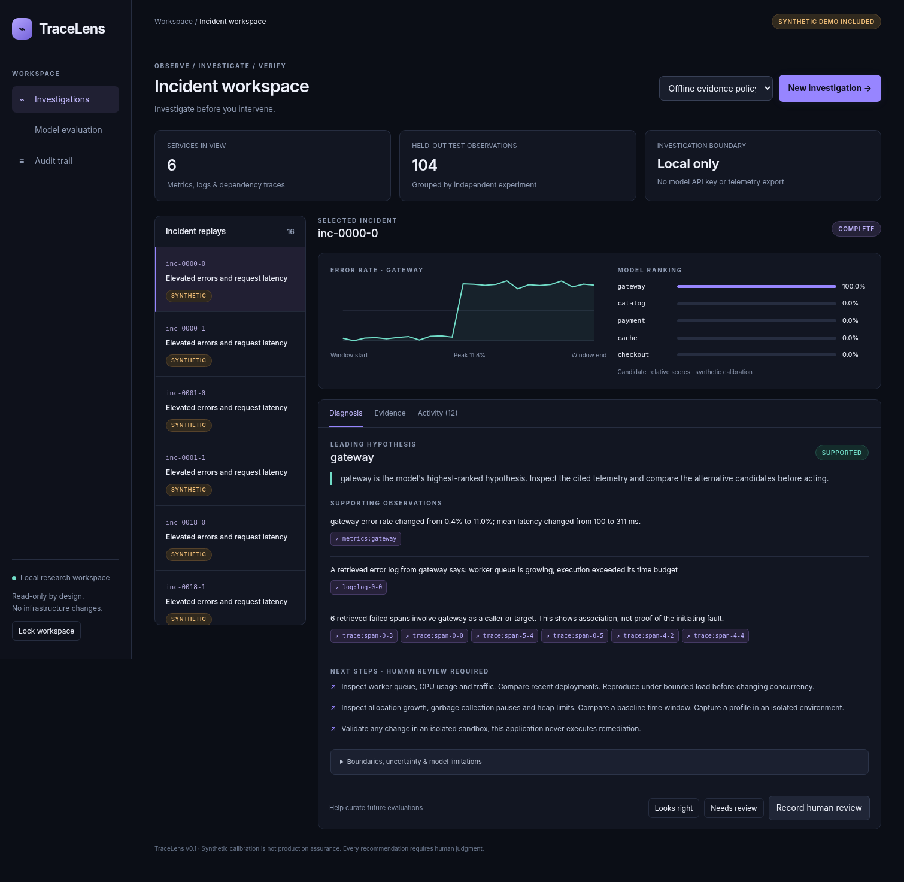
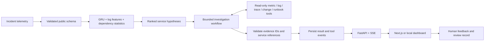

<div align="center">

# TraceLens
### Investigate the incident. Inspect the evidence.

A local-first AI engineering project combining a **trained PyTorch service ranker**, **bounded evidence-gathering workflows**, and a **full-stack incident workspace**.

`PyTorch` · `FastAPI` · `Next.js / React` · `TypeScript` · `SQLAlchemy` · `OpenTelemetry`

</div>



> **Scope:** A runnable research/portfolio prototype, not a production SRE platform. The bundled training data is synthetic. The screenshot is from the bundled no-Node dashboard using real backend results, not a design mockup. A separate React/Next.js implementation is in `web/`.

## The problem

An application develops errors and latency across several services. The most visibly affected service is not necessarily the initiating service. TraceLens ranks candidate services, gathers supporting telemetry, links every observation to its source, and makes the uncertainty visible before a human decides what to do.

A normal session is: select an incident → run an investigation → inspect ranked services and cited evidence → review alternative explanations → record feedback. **No infrastructure changes are executed.**

## What's implemented

| Layer | Implementation |
|---|---|
| Machine learning | A compact, trained GRU/log/statistics fusion ranker; an independently trained gradient-boosting baseline; a simple error/latency heuristic; separately retrained no-log and no-graph ablations. |
| Evaluation | Experiment-group splits; held-out service/fault combinations; top-1/top-3 accuracy, MRR, NLL, ECE; validation-selected temperature and acceptance threshold; grouped bootstrap intervals. |
| Investigation | Eight read-only tool calls in the default deterministic workflow; optional Anthropic tool-calling loop with time/turn/call budgets, validated citations, and explicit offline fallback. |
| Application | Authenticated FastAPI API, bounded background queue, persisted investigation history and tool events, SSE replay, feedback, human-review records, and an audit trail. |
| Interfaces | A working no-Node dashboard served by FastAPI, plus a React/TypeScript Next.js application with a same-origin streaming proxy. |
| Telemetry | Normalized incident JSON; a bounded OTLP/JSON trace-file adapter; an executable OpenTelemetry SDK workload with controlled faults. |
| Packaging | CPU model weights, generated demo data, tests, Docker recipes, GitHub Actions, model/data cards, validation reports, and interview notes. |

**Offline policy is not an LLM agent.** It uses the trained ranker and a deterministic evidence-gathering strategy. Hosted mode actually lets an LLM select tools, but requires your own API key, model ID, and explicit export consent. This distinction is displayed in every result.

## Quick start: no paid API keys, no Node required

Use Python **3.11–3.13**; 3.12 is a good default. Initial dependency installation needs internet access. The bundled model is already trained.

```bash
python3 -m venv .venv
source .venv/bin/activate
python -m pip install --upgrade pip
python -m pip install -e ".[dev,otel]"
python scripts/setup.py
python -m tracelens.cli serve
```

On Windows PowerShell, create the environment with `py -3.12 -m venv .venv`, then activate it with `.\.venv\Scripts\Activate.ps1`. The remaining `python` commands are the same. Running under WSL also works.

Open **http://127.0.0.1:8000**, paste the local token printed by `setup.py`, and select **New investigation**. The token is saved only in your browser session, not in the URL. API documentation is at `/docs`; use the **Authorize** button with your token.

`setup.py` never overwrites an existing `.env`. Your token is also in that file. Do not commit it.

### Next.js / React interface

Keep the Python API running in one terminal. In another:

```bash
cd web
npm install
npm run typecheck
npm run build
npm run start
```

Open **http://localhost:3000** and use the same local token. For interactive development use `npm run dev` instead of build/start. The proxy defaults to `http://127.0.0.1:8000`; override it with `API_ORIGIN` in `web/.env.local`.

The direct Next.js and React versions are pinned. A full npm lockfile could not be generated in the network-restricted build environment. Generate and commit `web/package-lock.json` after your first successful install, then switch repeat installs/CI to `npm ci`.

**Validation boundary:** Python, the model, the bundled dashboard, and shared TypeScript API utilities were exercised here. The full Next.js install/build, Docker images, PostgreSQL service, MLflow and LangGraph optional dependencies, and a paid hosted-model call were not executed here. See [the validation record](reports/VALIDATION.md).

## Reproduce training and evaluation

```bash
python scripts/generate_data.py --seed 42 --repeats 12
python -m tracelens.ml.train --seed 42 --epochs 60
python scripts/prepare_demo.py
python -m pytest -q
node --test tests/frontend.test.mjs
```

The generator produces **720 incident observations from 360 experiment groups** across six services and five fault families. Both observations of each experiment remain in the same split. `prepare_demo.py` exports the first 12 test and first 4 challenge observations, without looking at whether the model predicts them correctly.

The model receives only telemetry. Labels live in `data/labels.jsonl` and are not read by the API or investigation tools. Public imports cannot add label fields and are never promoted to trusted synthetic evaluation data.

### Included measured results

| Model | Test top-1 | Test top-3 | Challenge top-1 |
|---|---:|---:|---:|
| Full neural ranker | 98.1% | 100.0% | 98.6% |
| No-log ablation | 95.2% | 100.0% | 94.4% |
| No-graph ablation | 99.0% | 100.0% | 99.3% |
| Gradient boosting | 93.3% | 100.0% | 95.1% |
| Error/latency heuristic | 38.5% | 87.5% | 31.2% |

**These are synthetic results, not RCAEval or production results.** The no-graph ablation slightly outperforms the full model on this test: extra features do not automatically help. The project reports that result rather than hiding it. Do not describe this as “98% real-world root-cause accuracy.”

See [evaluation details](reports/EVALUATION.md), [machine-readable results](reports/evaluation.json), and the [model card](docs/MODEL_CARD.md). A single seed and a small validation set do not establish robust uncertainty estimates. Imported telemetry is explicitly marked outside the model's calibration domain.

## How the architecture works



Citations are **reference-checked**, not automatically proven to entail the claim. The model identifies associations, not established causality. The deterministic mode's factual observations are assembled directly from retrieved values; hosted model claims still require human review.

## Try real instrumentation locally

```bash
python examples/otel_lab.py --out examples/lab-traces.json
python scripts/import_otlp.py examples/lab-traces.json \
  --id my-otel-lab --out examples/my-lab-incident.json
python -m tracelens.cli rank examples/my-lab-incident.json
```

This creates actual SDK spans from a small **in-process, logically separated workload** with intentionally injected timeouts. It is not a deployed microservices cluster. The adapter supports a subset of OTLP trace JSON, not a streaming collector or every OTLP signal. CPU, memory and queue measurements are unavailable in these files; they are encoded as zero/unknown and predictions are treated as uncalibrated.

To import a normalized incident into the UI, use `POST /api/incidents` through `/docs` or [the example API script](examples/api_client.py). The API forces uploaded sources to `imported`; model ranking remains available, but the diagnosis cannot silently become calibration-assured.

## Optional hosted investigation

Add to your **untracked** root `.env`:

```dotenv
ANTHROPIC_API_KEY=your-own-key
TRACELENS_LLM_MODEL=an-available-tool-capable-model-in-your-account
TRACELENS_ALLOW_EXTERNAL_TELEMETRY=true
```

Restart the API and select hosted mode. This can send redacted excerpts to the configured provider and incur charges. Use only data you are permitted to share; regex redaction is not a privacy boundary. The provider has no shell, arbitrary HTTP, SQL, cloud-write, or filesystem tools.

The adapter allows at most six provider rounds, ten read-only tool calls, 1,400 generated tokens per round, and an approximately 45-second request budget. It records token usage. Network timeouts and invalid citations produce an **explicitly labeled offline fallback**, not a fabricated hosted answer. Hosted behavior was tested with mocked HTTP responses; no paid API calls were made during creation.

## Optional experiment tracking and graph orchestration

```bash
python -m pip install -e ".[tracking,graph]"
python -m tracelens.ml.train --mlflow-dir ./mlruns
```

An optional LangGraph adapter is in `src/tracelens/agents/graph.py` and a usage script is in `examples/langgraph_workflow.py`. The default API does not require either dependency. Do not list either as personally validated until you run it.

## Container deployment

```bash
python scripts/setup.py
# API + local dashboard (SQLite)
docker compose up --build
# Add the Next.js frontend
docker compose --profile web up --build
```

The API binds to loopback on port 8000. Persistent state is a named volume. For the optional PostgreSQL override, follow [deployment notes](docs/DEPLOYMENT.md). No AWS resources are created and no live cloud deployment is claimed.

## Repository map

```text
src/tracelens/
  ml/                    features, ranker, training, metrics
  agents/                tools, evidence policy, hosted adapter, optional graph
  integrations/          OTLP trace-file conversion
  static/                no-Node dashboard
  api.py / store.py      endpoints and portable persistence
web/                     React/TypeScript Next.js application
scripts/                 data generation, setup, checks, imports, browser smoke
examples/                normalized incident, SDK workload, API client
artifacts/               trained NPZ weights and metadata
reports/                 actual evaluation and validation records
data/                    generated observations, separated labels, demo export
tests/                   ML, input safety, API, persistence, agent and UI tests
docs/                    architecture, model/data cards, security and portfolio notes
```

## Before publishing or putting this on a résumé

Run the setup and tests yourself, inspect a failed or inconclusive case, and make an improvement you can explain. Replace the synthetic-only evaluation with an independently sourced benchmark before claiming real incident-diagnosis performance. [Portfolio notes](docs/PORTFOLIO.md) include an accurate résumé entry and technical questions to prepare for.

This repository was created with AI assistance. It does not establish prior employment, historical deployment, customer adoption, or independent authorship. There is no fabricated commit history.

See [SECURITY.md](SECURITY.md) before handling real telemetry. MIT-licensed project code; external dependencies and any data you later import retain their own licenses.
